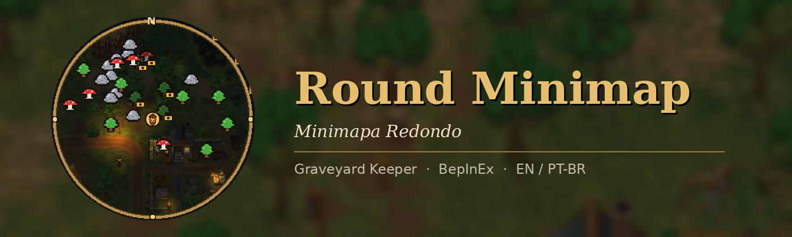
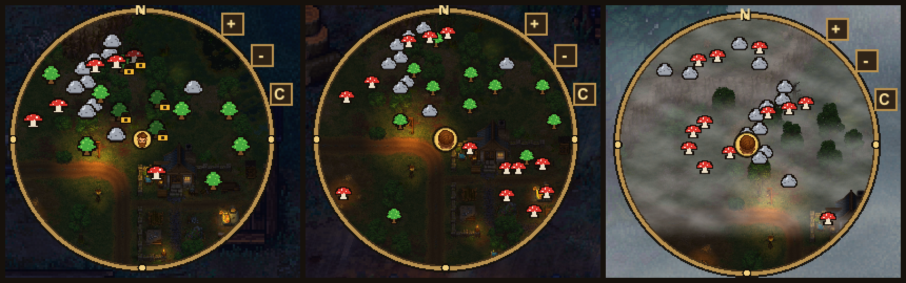

<p align="center"></p>

<p align="center"><b>O burro conhece o caminho até a vila. Agora você também.</b><br>
<i>The donkey knows the way to the village. Now you do too.</i></p>

A round, live minimap for **Graveyard Keeper** (BepInEx 5) — with your keeper's head in the middle.
Um minimapa redondo e ao vivo para o **Graveyard Keeper** — com a cabeça do seu personagem no meio.

## Features / O que ele faz
- **Live round map** in a golden ring matching the game's UI (square shape available).
- **Your keeper's head** as the marker, taken from the character sprite.
- **Icons that don't guess**: asks the game which tool each object needs — axe = wood, pickaxe/shovel = minerals, hands = forageables.
- **Research-aware**: things that still need technology show grey with a padlock and turn coloured when unlocked.
- **Layers** (L / C in PT-BR): wood, minerals, forageables, villagers.
- **5 zoom levels** plus a separate, automatic **indoor zoom**.
- **No pop-in** (keeps the map area loaded) and **no stutter** (world scanned a slice per frame).
- **Gets out of the way** with inventory, dialogues, workbenches and the game map open. **F6** show/hide, drag to move.
- **English and Brazilian Portuguese**, following the game's language. **Read-only**: never touches your save.



## Install / Instalação
1. Install the [Graveyard Keeper BepInEx 5 Pack](https://www.nexusmods.com/graveyardkeeper/mods/79).
2. Put `RoundMinimap.dll` in `Graveyard Keeper\BepInEx\plugins\RoundMinimap\` (or use Vortex).
3. Start the game. Options: **F1** (Configuration Manager).

## Build
```
dotnet build -c Release -p:GameDir="C:\path\to\Graveyard Keeper"
```
Targets .NET Framework 4.7.2 and references the game's `Managed` DLLs and `BepInEx\core\BepInEx.dll`
(nothing from the game is included in this repository).

## Nexus page
The Nexus description lives in [`docs/nexus/description.bbcode`](docs/nexus/description.bbcode); its images are served from `docs/nexus/`.

## License
MIT — see [LICENSE](LICENSE). Original code; made with AI assistance.
